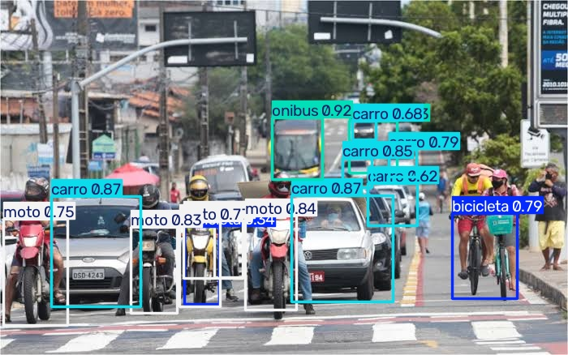

# Detecção de Veículos em Imagens de Trânsito com YOLO

Atividade Prática Final de **Inteligência Artificial** (UNIFEG). Aluno: **Olimpio Junior**.

Modelo **YOLO11s** treinado para detectar 5 classes de veículos (**bicicleta, carro, moto, ônibus e caminhão**) em fotos de trânsito, com 384 imagens anotadas do COCO 2017.

## Resultados (validação, 77 imagens fora do treino)

| Precision | Recall | mAP50 | mAP50-95 |
|---:|---:|---:|---:|
| 0,659 | 0,545 | 0,599 | 0,371 |

As detecções nas 5 imagens inéditas estão em [`resultados/imagens_ineditas/`](resultados/imagens_ineditas/).



## Estrutura

| Caminho | Conteúdo |
|---|---|
| [`relatorio.pdf`](relatorio.pdf) | Relatório completo: dataset, treino, métricas, imagens inéditas, respostas às 6 questões |
| `dataset/` | Imagens e anotações YOLO (`train`/`val`) + `data.yaml` |
| `imagens_ineditas/` | 5 imagens de teste que não participaram do treino nem da validação |
| `modelo/best.pt` | Pesos do modelo final |
| `resultados/` | Detecções nas imagens inéditas, métricas em JSON e capturas do console |
| `runs/` | Gráficos e logs do treino final, do experimento 1 e da validação |
| [`comandos.txt`](comandos.txt) | Comandos executados em cada etapa |
| [`USO_DE_LLM.md`](USO_DE_LLM.md) | Declaração de uso de LLM (Claude Code / Claude Opus 5.5) |

## Como reproduzir

```powershell
py -m venv .venv
.\.venv\Scripts\Activate.ps1
pip install -r requirements.txt
pip install --force-reinstall --no-deps torch torchvision --index-url https://download.pytorch.org/whl/cu134   # GPU NVIDIA

python prepare_dataset.py   # baixa o COCO 2017, filtra veículos e monta o dataset
python treinamento.py       # treina o YOLO11s (GPU, freeze=10)
python validar.py           # Precision, Recall, mAP50
python predicao.py          # detecções nas 5 imagens inéditas
python gerar_relatorio.py   # gera o relatorio.pdf
```

> Observação: `dataset/data.yaml` usa o caminho absoluto da máquina onde o projeto foi executado. Rodar `prepare_dataset.py` regenera o arquivo com o caminho local.
